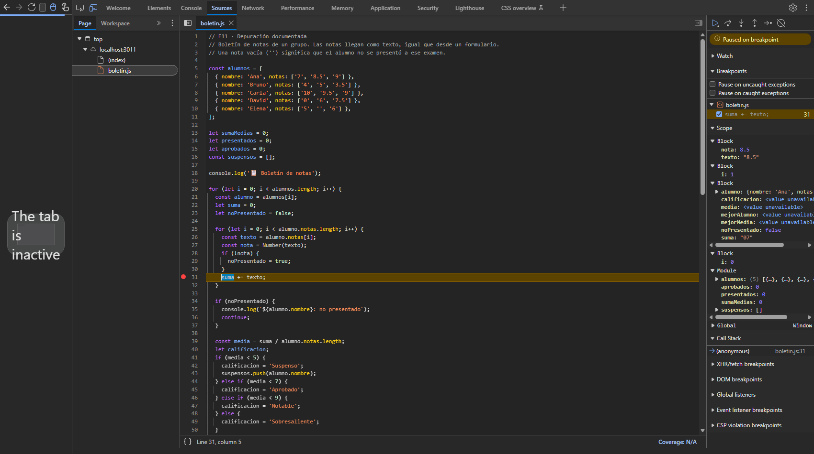
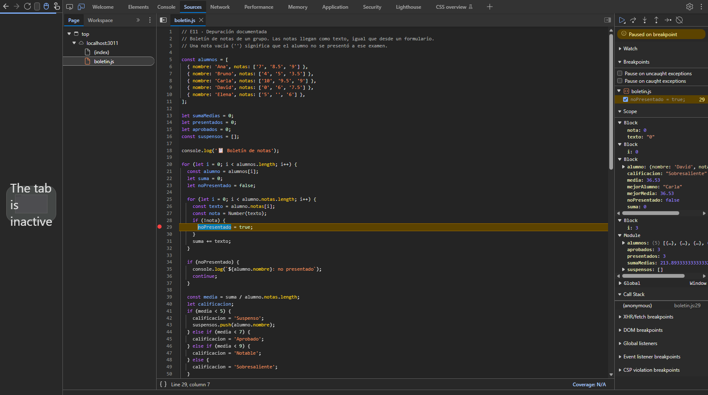
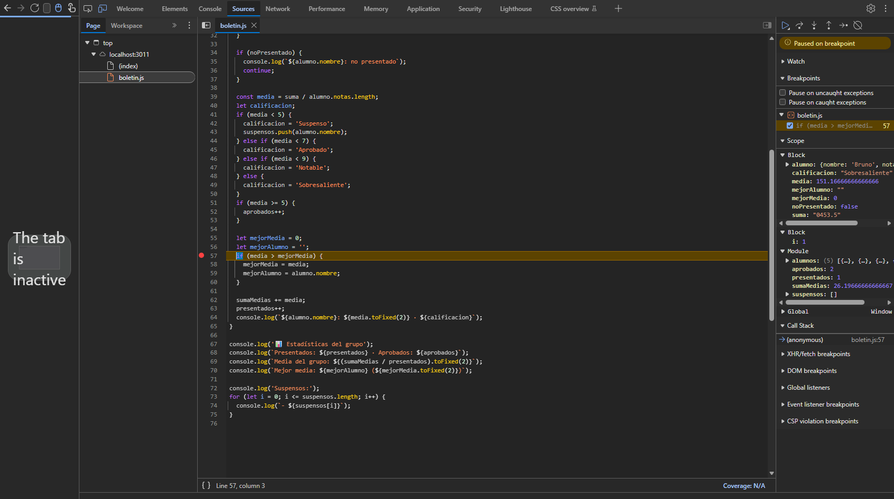

# Depuración documentada

Programa `boletin.js`: boletín de notas de cinco alumnos con tres notas cada uno (llegan como texto), calificación, estadísticas del grupo y lista de suspensos. Tenía seis errores (de ámbito, de bucles y de conversión de tipos) que se han corregido con un commit por error.

Repositorio con el historial de commits: <https://github.com/Javi7142/dwec-ud2-e11-depuracion-documentada>

## Errores encontrados

Las líneas son las del `boletin.js` original. Los errores 3, 4 y 5 se investigaron con el depurador (capturas en «Sesión de depuración»); el 1, el 2 y el 6 se encontraron con la ejecución y con ESLint.

| # | Línea | Síntoma | Cómo lo encontré | Tipo | Causa | Corrección |
|--:|------:|---------|------------------|------|-------|------------|
| 1 | 15 | `ReferenceError: aprobados is not defined` y el programa se detiene en esa línea | Al ejecutar (`node boletin.js`) y ESLint (regla `no-undef`: `'aprobados' is not defined`, líneas 15, 52 y 68) | Ámbito | Variable **global implícita**: `aprobados = 0;` asigna a una variable que nunca se declaró. En un módulo (modo estricto) es un error; en un script clásico habría creado una global sin avisar | `let aprobados = 0;` |
| 2 | 20 y 25 | El programa **no termina**: tras mostrar a Ana pasa directamente a Elena y repite `Elena: no presentado` sin parar (hay que cortarlo con `Ctrl+C`) | Al ejecutar (se queda colgado) y ESLint (`no-var` en las líneas 20 y 25 y `no-redeclare`: `'i' is already defined`) | Bucle (y ámbito) | Los dos `for` declaran `var i`: es **la misma variable** (`var` tiene ámbito de función, no de bloque). El bucle interior la deja en 3 al terminar, el `i++` del exterior la pasa a 4 (Elena) y ahí, al acabar el interior, vuelve a valer 3 y a 4 para siempre: bucle infinito | `for (let i …)` en los dos bucles: cada `i` tiene su propio ámbito de bloque |
| 3 | 31 | Las medias salen absurdas: `Ana: 26.20 · Sobresaliente`, `Bruno: 151.17 · Sobresaliente`, `Carla: 36.53 · Sobresaliente` | Depurador: punto de ruptura en la línea 31 (`suma += texto;`). En la segunda pausa, el panel Ámbito muestra `suma: "07"` (con comillas: un **texto**), `texto: "8.5"` y `nota: 8.5` | Conversión | `suma += texto` suma un texto: con un `string` el operador `+` **concatena** (`0 + '7'` da `'07'`, después `'07' + '8.5'` da `'078.5'`…). Después se divide ese texto entre 3 y JavaScript lo convierte a número: `'0789' / 3` da 26.2 | `suma += nota;` (el valor ya convertido con `Number(texto)`) |
| 4 | 28 | David (`'0'`, `'6'`, `'7.5'`) sale `no presentado` (y `Presentados: 3` en lugar de 4) | Depurador: punto de ruptura en la línea 29 (`noPresentado = true;`), que solo se ejecuta si el alumno no se presentó. Se detiene con `alumno: David`, `texto: "0"` y `nota: 0` | Conversión | `if (!nota)` trata como «no presentado» cualquier valor *falsy*, y el número `0` lo es. Pero un `'0'` es una nota válida: solo la nota vacía (`''`) es no presentado | `if (texto.trim() === '')`: se comprueba el texto, no el número convertido |
| 5 | 55-56 y 70 | `ReferenceError: mejorAlumno is not defined` en la línea 70 y, aunque no diera error, la mejor media se reiniciaría en cada alumno | Al ejecutar (mensaje de error) y ESLint (`no-undef` en la línea 70, `no-useless-assignment` y `no-unused-vars` en las líneas 58 y 59). Con el depurador, punto de ruptura en la línea 57: en la segunda pausa (Bruno), `mejorMedia: 0` y `mejorAlumno: ""` en el bloque, de nuevo a cero, y no existen en el ámbito del módulo | Ámbito | `let mejorMedia` y `let mejorAlumno` se declaran **dentro del bucle**: son de **ámbito de bloque**, se crean de nuevo (a 0 y `''`) en cada vuelta y no existen fuera del bucle, donde se usan en la línea 70 | Declararlas antes del bucle, junto a `sumaMedias` y `presentados`, en el ámbito del módulo |
| 6 | 73 | Al final de la lista de suspensos aparece una línea `- undefined` | Al ejecutar: la salida muestra `- Bruno`, `- David` y `- undefined` (se detecta al comparar con la salida esperada; ESLint no lo ve) | Bucle | **Error por uno** (*off-by-one*): `i <= suspensos.length` hace una vuelta de más y lee `suspensos[2]`, que no existe | `i < suspensos.length` |

## Sesión de depuración

Sesión del **error 3** (las medias absurdas), con las DevTools de Edge (Sources) ejecutando `boletin.js` como módulo desde una página servida con `serve`:

1. **Sospecha y punto de ruptura.** Las medias eran enormes (26.20 para unas notas de 7, 8.5 y 9), así que sospeché de la suma de las notas. Puse un punto de ruptura **normal** en la línea 31, `suma += texto;`, el único sitio donde se acumula la suma, y recargué la página.
2. **Valores esperados y vistos.** Esperaba que `suma` fuera un número (`0`, luego `7`, luego `15.5`…). En la primera pausa `suma` valía `0` y `texto` era `"7"`. Reanudé una vez (botón de reanudar, `F8`) y en la segunda pausa el panel **Ámbito** mostraba `nota: 8.5` (número, en azul), `texto: "8.5"` y, sobre todo, `suma: "07"`, con comillas: ya no era un número, sino el texto resultante de concatenar `0` y `'7'`.
3. **Controles y conclusión.** Usé reanudar entre pausas y el panel Ámbito para comparar los tipos (`nota` es número y `suma` es texto). Conclusión: `suma += texto` concatena en lugar de sumar; hay que sumar `nota`, que es el valor ya convertido con `Number`. Corregí la línea y las medias pasaron a ser las esperadas (Ana 8.17).



En la captura se ve el depurador detenido en el punto de ruptura de la línea 31 (resaltada, con el punto rojo) y, en el panel Ámbito de la derecha, `nota: 8.5`, `texto: "8.5"` y `suma: "07"` (texto, con comillas).

**Error 4 (nota 0).** Punto de ruptura en la línea 29, que solo se ejecuta cuando el programa decide que el alumno no se presentó. La primera vez que se detiene es con `alumno: {nombre: 'David', …}`, `texto: "0"` y `nota: 0`: el depurador demuestra que David sí tiene nota, un `0`, y que `!nota` es verdadero para el número 0.



En la captura se ve la pausa en la línea 29 y en el panel Ámbito `nota: 0` y `texto: "0"` (la nota de David es válida, pero el `if (!nota)` la ha tomado como no presentado).

**Error 5 (mejor media).** Punto de ruptura en la línea 57 (`if (media > mejorMedia)`): en la segunda pausa, con Bruno, `mejorMedia` vale `0` y `mejorAlumno` vale `""` otra vez, y el bloque de Módulo no las contiene: cada vuelta las crea de nuevo y por eso no pueden usarse después del bucle.



En la captura se ve la pausa en la línea 57 con `mejorAlumno: ""` y `mejorMedia: 0` dentro del bloque del bucle (con `alumno: Bruno`), mientras que el ámbito del módulo (`Module`) solo tiene `alumnos`, `aprobados`, `presentados`, `sumaMedias` y `suspensos`.

## ESLint antes y después

Salida de `npm run lint` **antes** de los cambios (11 errores):

```text
boletin.js
  15:1   error  'aprobados' is not defined                                               no-undef
  16:5   error  'suspensos' is never reassigned. Use 'const' instead                     prefer-const
  20:6   error  Unexpected var, use let or const instead                                 no-var
  25:8   error  Unexpected var, use let or const instead                                 no-var
  25:12  error  'i' is already defined                                                   no-redeclare
  52:5   error  'aprobados' is not defined                                               no-undef
  58:5   error  The value assigned to 'mejorMedia' is not used in subsequent statements  no-useless-assignment
  59:5   error  'mejorAlumno' is assigned a value but never used                         no-unused-vars
  68:57  error  'aprobados' is not defined                                               no-undef
  70:29  error  'mejorAlumno' is not defined                                             no-undef
  70:45  error  'mejorMedia' is not defined                                              no-undef

✖ 11 problems (11 errors, 0 warnings)
```

Salida **después** (sin errores) y `npm run format:check`:

```text
> npm run lint
> eslint .

> npm run format:check
Checking formatting...
All matched files use Prettier code style!
```

**Qué detectó ESLint y qué no:**

- **Detectó los errores 1, 2 y 5**, que son errores de **declaración y ámbito**, algo que se ve mirando solo el código: una variable sin declarar (`no-undef`), `var` y variable redeclarada (`no-var`, `no-redeclare`) y variables declaradas en un bloque y usadas fuera (`no-undef` en la línea 70, `no-useless-assignment` y `no-unused-vars`). También avisó de un `prefer-const` en `suspensos` (línea 16), que no es uno de los seis errores y se corrigió con `const`.
- **No detectó los errores 3, 4 y 6**, que son errores de **lógica y de valores en tiempo de ejecución**: `suma += texto` es código válido (sumar a un texto no es un error de sintaxis ni de ámbito); `!nota` es una comprobación válida que solo es incorrecta por lo que significa el `0` en este programa; y `i <= suspensos.length` es un bucle perfectamente válido que simplemente da una vuelta de más. ESLint no sabe qué quería hacer el programa ni qué valores toman las variables al ejecutarse; eso solo se descubre ejecutando, depurando o con tests.

## Pruebas realizadas

Cambiando temporalmente los datos de `alumnos` (y dejándolos después como estaban); en todos los casos se ejecutó `node boletin.js`.

| # | Cambio en los datos | Resultado esperado | Resultado obtenido | ¿Correcto? |
|--:|---------------------|--------------------|--------------------|:----------:|
| 1 | Ana con las tres notas a `'0'` (y Bruno con `'6'`, `'6'`, `'6'`) | `Ana: 0.00 · Suspenso` (el `'0'` es una nota válida, no «no presentado»), 2 presentados y Ana en la lista de suspensos | `Ana: 0.00 · Suspenso`, `Presentados: 2 · Aprobados: 1`, media del grupo `3.00` y `- Ana` en los suspensos | ✅ |
| 2 | Grupo sin suspensos (Ana `7, 8.5, 9`; Bruno `5, 5, 5`) | Lista de suspensos vacía y 2 aprobados | `Aprobados: 2` y `Suspensos:` sin ninguna línea debajo (Bruno, con media 5.00, es `Aprobado`) | ✅ |
| 3 | Ana con una nota `'10'` y dos vacías (`'10'`, `''`, `''`) | `Ana: no presentado` (le faltan dos exámenes) y no cuenta en las estadísticas | `Ana: no presentado`, `Presentados: 1` (solo Bruno) y la media del grupo es la de Bruno (`7.00`) | ✅ |
| 4 | Medias justo en los límites (5, 7 y 9) y una de 4.97 | `5.00` Aprobado, `7.00` Notable, `9.00` Sobresaliente y `4.97` Suspenso | `A: 5.00 · Aprobado`, `B: 7.00 · Notable`, `C: 9.00 · Sobresaliente`, `D: 4.97 · Suspenso` | ✅ |
| 5 | Nadie se presenta (todas las notas vacías o con una vacía) | Cero presentados; la media del grupo no se puede calcular | `Presentados: 0`, `Media del grupo: NaN` y `Mejor media:  (0.00)` | ⚠️ No es un error de los seis, pero tampoco es un buen resultado: se divide `sumaMedias / presentados` entre 0 (`0 / 0` da `NaN`) y no hay mejor alumno. Habría que comprobar `presentados === 0` antes de calcular; no se cambia porque el formato de salida del enunciado es fijo |
